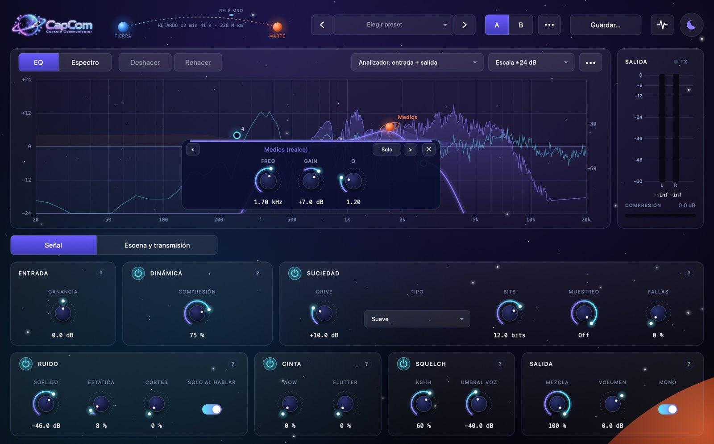
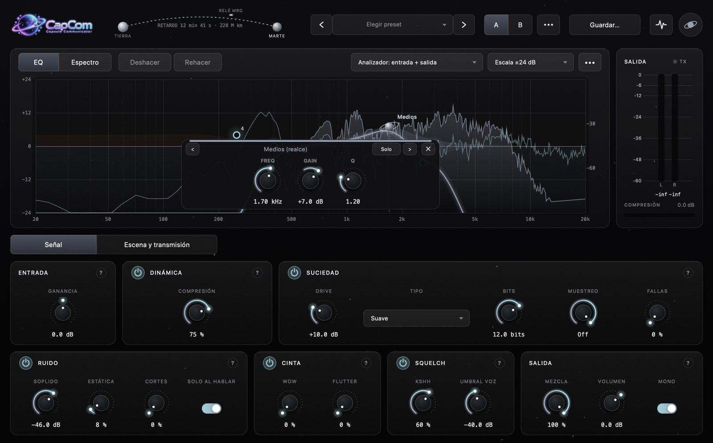
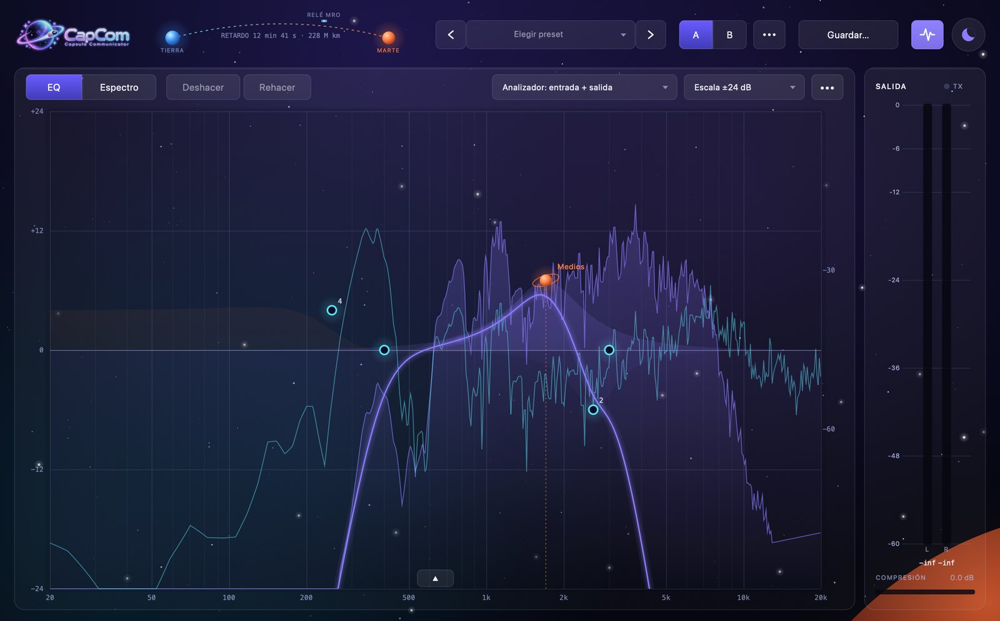

<p align="center">
  
</p>

<p align="center">
  <b>Voces de radio, walkie-talkie, NASA, teléfono, celular y VHS para tus videos.</b><br>
  Plugin gratuito y de código abierto para DaVinci Resolve, Premiere Pro y cualquier editor con VST3 o AU.
</p>

<p align="center">
  <a href="../../releases/latest"><b>⬇️ Descargar para Mac o Windows</b></a>
</p>



**CapCom** (*Capsule Communicator*, el nombre de quien hablaba por radio con los astronautas) convierte cualquier voz en una transmisión: la radio de la patrulla, la central de policía, el walkie militar, el "Houston, tenemos un problema", una llamada por celular con cortes o una cinta VHS gastada. También pone la voz dentro de una escena: el aparato que la reproduce, el lugar, la distancia y una pared de por medio.

Funciona **dentro** de tu editor (no tienes que exportar ni salir del programa) y también como **app independiente** para procesar archivos sueltos.

## Qué incluye

- **14 presets listos:** Radio policial, Walkie militar, NASA Apollo (con o sin los bips Quindar), Teléfono fijo, Celular, VHS / Cassette, Patrulla afuera (desde la casa), Central en el cuarto de al lado, Central con roger beep, Megáfono policial, Celular en altavoz sobre la mesa, TV en otra habitación y Limpio.
- **Ecualizador gráfico con puntos**, al estilo FabFilter Pro-Q: arrastras los puntos sobre la curva, con analizador de espectro, solo por banda, deshacer/rehacer y vista de solo ecualizador.
- **Señal de radio:** compresor con medidor, saturación, degradación digital (bits y muestreo), fallas de códec de celular, soplido, estática, cortes, wow y flutter de cinta, squelch ("kshh"), bips Quindar de la NASA y roger beeps (Motorola, Nextel, militar…).
- **Escena:** 10 aparatos (radio de patrulla, TV antigua, laptop, celular en altavoz, megáfono, portero eléctrico…), distancia, 9 espacios (baño, pasillo, garaje, iglesia…) y obstáculos (puerta, pared, ventana, maletera, bolsillo…).
- **Transmisión manual:** automatiza el botón *Transmitir* en tu línea de tiempo para decidir cuándo empieza y termina cada mensaje.
- **Comparación A/B**, presets propios y dos temas: *Interplanetary* (morado) y *Modo noche* (negro).
- **Biblioteca de sonidos gratis** (aparte): kshh, roger beeps, Quindar, estática, tonos de teléfono de Perú y EE.UU., sirenas, alarma de auto, celular vibrando, golpes graves, subidas de tensión y más. Todo en WAV y libre para usar en videos comerciales.

| Modo noche | Solo ecualizador |
|---|---|
|  |  |

## Instalar

Descarga el `.zip` de tu sistema en **[Releases](../../releases/latest)**:

| Sistema | Archivo | Formatos |
|---|---|---|
| Mac (Apple Silicon M1–M4 **e Intel**, macOS 11+) | `CapCom-Mac.zip` | AU, VST3 y app |
| Windows 10/11 (64 bits) | `CapCom-Windows.zip` | VST3 y app |
| Sonidos (opcional) | `CapCom-Biblioteca.zip` | WAV 48 kHz / 24 bits |

Cada zip trae un archivo `INSTALAR` con los pasos. En corto:

**Mac**
1. Copia `CapCom.component` a `~/Library/Audio/Plug-Ins/Components` y `CapCom.vst3` a `~/Library/Audio/Plug-Ins/VST3` (en Finder: *Ir → Ir a la carpeta…*, `Cmd + Shift + G`).
2. El plugin no está firmado por Apple, así que macOS lo bloquea. En Terminal:
   ```bash
   xattr -dr com.apple.quarantine ~/Library/Audio/Plug-Ins/Components/CapCom.component ~/Library/Audio/Plug-Ins/VST3/CapCom.vst3 /Applications/CapCom.app
   ```
3. Reinicia tu editor.

**Windows**
1. Copia la carpeta `CapCom.vst3` a `C:\Program Files\Common Files\VST3`.
2. Si Windows muestra *"Windows protegió su PC"* al abrir `CapCom.exe`: *Más información → Ejecutar de todas formas*.
3. Reinicia tu editor.

### En DaVinci Resolve

1. *Preferencias → Sistema → Efectos de audio*. En **Efectos VST**, revisa que esté la carpeta donde copiaste `CapCom.vst3` (en Mac, agrega `~/Library/Audio/Plug-Ins/VST3`). Guarda y reinicia DaVinci.
2. En la página **Fairlight** (o en el mezclador), en la ranura de efectos de la pista, busca **CapCom** en *VST* o *AU*. También puedes arrastrarlo desde *Efectos → Audio FX* al clip. Funciona en la versión gratuita.

### En Premiere Pro

1. *Preferencias → Audio → Administrador de plugins de audio → Buscar plugins*.
2. En *Efectos → Efectos de audio*, busca **CapCom** y arrástralo al clip.

### App independiente

Abre `CapCom.app` (Mac) o `CapCom.exe` (Windows), arrastra tu audio a la ventana, ajusta mientras suena y pulsa **Exportar WAV**.

## Cómo se usa

1. Elige un **preset** con `<` `>` arriba.
2. Ajusta con las perillas. Cada sección tiene un botón **⏻** para apagarla y comparar, y un **?** que explica qué hace. Doble clic en una perilla la devuelve a su valor por defecto.
3. Pestaña **Señal**: cómo suena la transmisión. Pestaña **Escena y transmisión**: desde dónde y por dónde suena, y los bips.
4. Usa **A / B** para comparar dos versiones y *Guardar…* para tus propios presets.

**Gestos del ecualizador** (en Windows, `Cmd` = `Ctrl` y `Option` = `Alt`):

| Gesto | Qué hace |
|---|---|
| Doble clic en el fondo | Nueva banda |
| Arrastrar un punto | Frecuencia y ganancia |
| Rueda del mouse | Q (o pendiente en los cortes) |
| `Shift` | Ajuste fino |
| `Option` + clic | Bypass de la banda |
| `Cmd` + `Option` + clic | Cambia la forma |
| Clic derecho | Menú del punto |
| `Supr` / `Borrar` | Borra la banda elegida |

**Consejos**
- Para que un sonido suene *dentro* de la radio (por ejemplo, sirenas detrás de la central), ponlo en su propia pista y aplícale CapCom con el mismo preset que la voz.
- El bip Quindar de inicio suena encima de la primera sílaba (el plugin no puede adelantarse a la voz). Si lo quieres limpio, deja un silencio corto antes de la frase.
- Para que la biblioteca aparezca en DaVinci: *Sound Library → … → Add Library* y elige la carpeta `Biblioteca`. En Premiere: en el *Explorador de medios*, clic derecho → *Agregar a favoritos*.

## Compilar desde el código

Necesitas [CMake](https://cmake.org) 3.22 o más nuevo y un compilador de C++17: en Mac, las *Command Line Tools* de Xcode (`xcode-select --install`); en Windows, Visual Studio 2022 con "Desarrollo para el escritorio con C++". JUCE se descarga solo.

```bash
cmake -S . -B build -DCMAKE_BUILD_TYPE=Release
cmake --build build --config Release --parallel
```

Los archivos quedan en `build/CapCom_artefacts/Release/`. En Mac se compila un binario universal (Apple Silicon + Intel) y el AU y el VST3 se copian solos a `~/Library/Audio/Plug-Ins`.

Cada push a `main` compila Mac y Windows en GitHub Actions. Para publicar una versión, crea una etiqueta `v1.0.0`: se arma una *Release* con los tres `.zip`.

**Estructura**

| Archivo | Qué contiene |
|---|---|
| `Source/RadioEngine.*` | La señal de radio: filtros, compresor, saturación, ruido, squelch, fallas de códec, Quindar, roger beep, transmisión manual |
| `Source/SceneEngine.*` | Aparato, obstáculo, distancia y espacio (tablas de modelos al inicio del archivo) |
| `Source/RadioChain.*` | Une todo en orden: radio → escena → volumen |
| `Source/Parameters.h` | Parámetros y presets de fábrica |
| `Source/PluginProcessor.*` | El plugin, los presets del usuario y el reproductor/exportador de la app |
| `Source/PluginEditor.*`, `Source/Style.h` | La interfaz y los temas |
| `Source/EqEditor.*` | El ecualizador gráfico y el analizador |
| `tools/biblioteca.py` | Genera los sonidos sintéticos de la biblioteca |
| `tools/Snapshot.cpp` | Herramienta de desarrollo: dibuja la interfaz a PNG y exporta audio con un preset |

Si agregas parámetros, ponlos **al final** y con un valor por defecto que no cambie el sonido: DaVinci y Premiere guardan los parámetros en los proyectos.

## Licencia

- **Código:** [GNU AGPLv3](LICENSE). Puedes usarlo, copiarlo, modificarlo y compartirlo gratis. Si distribuyes una versión modificada, también tienes que publicar su código bajo la misma licencia.
- **Sonidos de la biblioteca:** CC0 y dominio público. Detalle en [`Biblioteca/LICENCIAS.txt`](Biblioteca/LICENCIAS.txt).
- Hecho con [JUCE](https://juce.com) (AGPLv3). VST es una marca registrada de Steinberg Media Technologies GmbH.

---

### English

**CapCom** is a free, open-source audio plugin (VST3 / AU / standalone, macOS universal and Windows) that turns any voice into a police radio, military walkie-talkie, NASA Apollo transmission (with Quindar tones), landline, cell phone or VHS tape, and can place it inside a scene (device, room, distance and obstacles). It includes a point-based graphic EQ with a spectrum analyzer, 14 presets, A/B comparison and a free CC0 sound library. Download it from [Releases](../../releases/latest). The UI is in Spanish. Licensed under AGPLv3.
